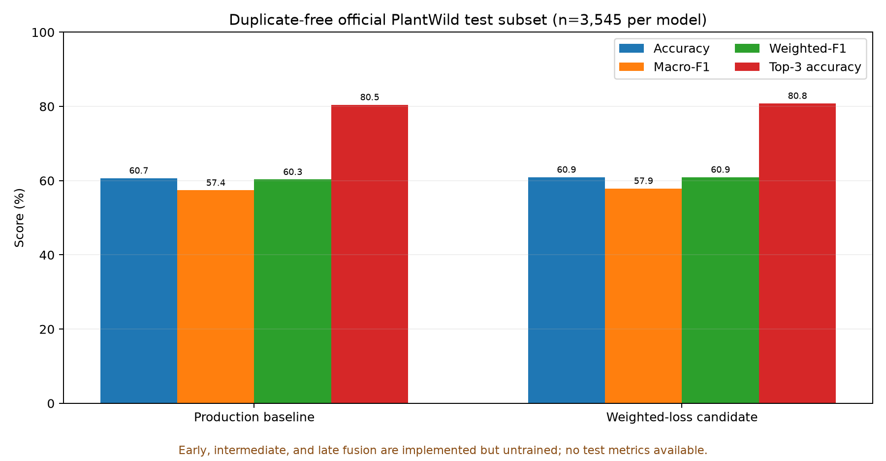

# TerraMind AI: Multimodal Fusion and Agricultural Decision Support

**Final experimental status:** the three fusion architectures are implemented, selectable, and unit-tested, and the fusion inference API and frontend client are integrated. However, no valid paired text dataset and no trained fusion checkpoints are available. Therefore, this report does not claim a three-way fusion result. The measured classifier comparison is between the image-only EfficientNet-B0 and one separate, one-epoch class-weighted candidate. Caption generation for the model-generated (experimental) track is still running, and the generated captions are measurably too generic to support a valid multimodal claim; see [caption_quality_audit.md](caption_quality_audit.md) and [three_fusion_models_implementation_report.md](three_fusion_models_implementation_report.md).

## Abstract

TerraMind AI is a decision-support prototype that combines a PlantWild image classifier with retrieval-augmented agricultural guidance. This report consolidates persisted measurements for the production EfficientNet-B0, a class-weighted experimental candidate, and a ten-query source-retrieval evaluation. The matched duplicate-free official test comparison measured 60.68% accuracy and 57.40% macro-F1 for the baseline, versus 60.93% and 57.90% for the candidate. The candidate remains experimental. Early, intermediate, and late fusion are implemented, selectable, and unit-tested but **untrained and not evaluated**: the only per-image text available is a still-generating set of model-generated captions that is measurably too generic (28.7% unique descriptions; 71.5% of duplicate-caption groups span more than one disease class) to carry class-discriminative signal, and no genuinely human-authored, per-image paired observations exist. Their test metrics are therefore `NOT EVALUATED`; see [caption_quality_audit.md](caption_quality_audit.md). RAG retrieval returned 251 points sourced from 218 documents; on ten manually labeled questions, precision@5 was 0.18. Local integration tests passed, but hosted services were not verified. Outputs are guidance and model predictions, not confirmed diagnoses.

## 1. Problem statement and objectives

Plant disease recognition in uncontrolled imagery is difficult because of visual variation within a disease class and similarity between classes. The project objective is to provide image-based candidate predictions and cite relevant agricultural knowledge while preserving uncertainty. The research objective is to compare an image-only baseline with three fusion mechanisms without test leakage or fabricated paired observations. The fusion comparison remains blocked by the data requirement described below.

## 2. System architecture

The Next.js interface calls a FastAPI service. The backend lazily loads the production EfficientNet-B0 for image inference, exposes explicit model availability, and uses a source-backed retrieval pipeline with TF-IDF embeddings and a local persistent fallback (Qdrant is optional). A supervisor routes selected requests to existing specialist workflows and records which agents ran. Optional LLM generation is server-configured; when no provider is configured, the backend returns an evidence-template response with citations. Supabase handles user identity and durable records when reachable; local report/review files are a fallback, not cross-device persistence. The frontend displays model scores separately from test-set metrics and exposes uncertainty/review paths.

## 3. Dataset and split protocol

The repository’s PlantWild v1 material describes 18,542 images across 89 classes and supplies official split metadata. The project artifacts record 13,045 training, 1,820 validation, and 3,677 test rows. Content-duplicate filtering excluded 69 validation and 132 test entries and yielded 1,751 validation and 3,545 test eligible images for the duplicate-free comparison. Model selection uses validation macro-F1; the comparison artifact records that test data was not used for selection.

**Duplicate-free eligibility manifest** (`outputs/research/fusion_eligibility_manifest.json`, format `terramind-duplicate-free-eligibility-v1`): SHA-256 over image bytes; cross-split duplicate groups are excluded entirely; within-split duplicates are kept only for the lexicographically-first sample unless class labels conflict. Official splits contain 18,542 images (13,045 / 1,820 / 3,677); the eligible, duplicate-free set is **17,870 images (train 12,573 / validation 1,751 / test 3,546**) across 89 classes. The matched image-only comparison uses the 3,545-row eligible test subset.

**Per-track paired-dataset sizes.** The paired schema is six columns (`sample_id, image_path, text, text_origin, provenance, source_reference`); target/split columns are forbidden. Two experimental tracks exist and are never mixed:

| Track | text_origin policy | Train | Validation | Test | Status |
|---|---|---|---:|---:|---:|---|
| A — human observations | `paired_human_observation` / `user_observation` | 0 | 0 | 0 | **BLOCKED** — no human-authored per-image text exists |
| B — model-generated captions (exploratory) | `model_generated_observation` | generating | 0 | 0 | **in progress / not trainable** |

Track B generation is still running (train split only at the time of writing); validation and test have zero generated captions, so the fusion training gate (`ml/fusion/train.py`) refuses to start and no paired dataset can be emitted for a valid train/validation experiment.

## 4. Image-only EfficientNet-B0 baseline

The unchanged production checkpoint is `models/final_model.pth` (SHA-256 `D958430372CF4F953BF26A629E465A8840D185D6A8C83A13243E9DC96F95F454`), with 89 outputs and 224-pixel input. Its companion training artifact records seed 42, 20 epochs, and best validation macro-F1 56.5659% at epoch 20. This is the serving checkpoint; its stored result reports accuracy 60.0218% and macro-F1 56.6969%.

A separate archived artifact, `models/archive/2026-09-09_efficientnet_b0_official_v3/best_model.pth` (SHA-256 `9AC45C5F…B5A28B`), is preserved for provenance but is **not** the served checkpoint. The production checkpoint `models/final_model.pth` is never overwritten by an experimental checkpoint; the three fusion architectures have no checkpoints at all.

### Reconciliation of production metrics

The stored result artifact does not record its test sample count or enough evaluation-protocol detail to reproduce the score. Independent evaluation of the named checkpoint on all 3,677 official test rows measured 59.72% accuracy and 56.50% macro-F1. A separate duplicate-free evaluation on 3,545 rows measured 60.68% and 57.40%. These values differ because the stored score and independent evaluation are not demonstrably the same evaluation record/protocol. We preserve all three and use only the duplicate-free baseline for the matched candidate comparison; we do not overwrite or average the records.

## 5. Early, intermediate, and late fusion methods

The repository implements reusable classifiers and training/evaluation interfaces in `ml/fusion/models.py`. Image features are the shared 1280-D EfficientNet-B0 penultimate features, pooled with `AdaptiveAvgPool2d(1)` and projected by `Linear(1280, 512)→LayerNorm→GELU`; text is a token embedding (padding id 0) fed to a bidirectional GRU and projected by `Linear→LayerNorm→GELU`.

- **Early fusion:** concatenate the projected image and text feature vectors before the classification head.
- **Intermediate fusion:** combine the projected encodings through a learned sigmoid gate over a joint projection (`gate * joint_projection([image; text]) + (1 - gate) * 0.5 * (image + text)`) before the head.
- **Late fusion:** `LateFusionClassifier` keeps separate image and text classifiers and combines their probabilities with a weight tuned on validation data; it also exposes a genuine image-only branch (`image_classifier`), so its missing-text behaviour is an explicitly labelled `image_only_fallback` rather than a silent fusion prediction.

All three are **implemented, selectable, and unit-tested but untrained and unavailable for inference**. They have no test accuracy, F1, confusion matrix, parameter/inference measurements, or checkpoint to report. Their blank metrics in the generated CSV/JSON mean `NOT EVALUATED`, not zero. The selectable runtime is `ml/fusion/inference.py` (`SUPPORTED_FUSION_KINDS = ("early","intermediate","late")`), which raises `FusionCheckpointUnavailable` when a checkpoint is absent and `MissingTextError` when paired text is required but missing (early and intermediate always require text; late may fall back and labels the result `image_only_fallback`).

## 6. Text modality and leakage controls

PlantWild provides class names and GPT-generated per-class descriptions, not independent farmer observations and not captions paired to each image. The existing multimodal preparation that uses class labels is class-conditioned; using it as model text would leak the target. The fusion pipeline therefore requires provenance-bearing per-image text, rejects label/target columns and class-name content, checks paths and split alignment, and fits the vocabulary on training text only. These structural checks cannot authenticate a curator’s provenance assertion, so provenance categories are kept strictly separate: `model_generated_observation` is never relabelled `user_observation`.

**Caption-quality finding (model-generated track).** The only per-image text being produced is label-free BLIP-base output. A measured quality audit (see [caption_quality_audit.md](caption_quality_audit.md)) at 7,863 completed captions found: 2,259 unique descriptions (28.7%); ~100% of stored rows still contain the prompt echo; 634 duplicate-caption groups; 453 of those groups (71.5%) span more than one disease class; 5,674 rows (72.2%) share an identical caption with a sample from a different class; mean length 15.46 words. Duplicated text that recurs across classes cannot carry class-discriminative signal, so training fusion on these captions could not support a valid multimodal-improvement claim. A bounded same-image prompt probe (n=12) was run rather than assumed: the production `v1` prompt was the worst variant for uniqueness (9/12 unique), while a symptom-oriented prompt produced 12/12 unique but only 6/12 symptom-bearing and shorter captions — a directional signal, not a statistical result. Structural QA on generated text flagged 2 label-leakage and 68 unsupported-disease-claim rows, all intercepted as non-blocking with a `human_verification` requirement.

Because a trustworthy fusion claim cannot be carried by this text, the honest paths are: **A** — use genuinely human-authored per-image observations (currently zero, so blocked); **B** — run a separately labelled exploratory experiment on the model-generated captions without claiming human-text validity (also currently blocked: validation and test have zero captions, so the trainer gate cannot be satisfied). These tracks are never mixed. Valid paired data must be collected or supplied, and be available at inference, before a defensible fusion experiment can proceed.

## 7. Experimental setup and image-only candidate

The candidate is an EfficientNet-B0 initialized compatibly with the production model and trained for one epoch using class-weighted loss on the official training split. It was selected on validation macro-F1 (58.2429% versus baseline 56.8672% on the duplicate-free validation subset). The comparison artifact records a 642.8-second filesystem interval from config creation to results write; this is not a trainer-only timer. It was evaluated on the same 3,545 duplicate-free official test examples as the baseline. Test metrics were not used to select it. The experimental checkpoint remains separate and is not promoted.

## 8. Measured model comparison

| Model/checkpoint | Evaluation subset | N | Accuracy | Macro-P/R/F1 | Weighted-F1 | Top-3 | Parameters | Size (MB) | CPU ms/image |
|---|---|---:|---:|---:|---:|---:|---:|---:|---:|
| Production EfficientNet-B0 v3 | Duplicate-free official test | 3,545 | 60.68% | 57.80%/59.28%/57.40% | 60.32% | 80.45% | 4,121,557 | 16.78 | 35.45 |
| One-epoch class-weighted candidate (not promoted) | Same duplicate-free official test | 3,545 | 60.93% | 58.00%/59.41%/57.90% | 60.94% | 80.82% | 4,121,557 | 16.78 | 32.34 |
| Early fusion | Not evaluated | — | NOT EVALUATED | NOT EVALUATED | NOT EVALUATED | NOT EVALUATED | NOT EVALUATED | NOT EVALUATED |
| Intermediate fusion | Not evaluated | — | NOT EVALUATED | NOT EVALUATED | NOT EVALUATED | NOT EVALUATED | NOT EVALUATED | NOT EVALUATED |
| Late fusion | Not evaluated | — | NOT EVALUATED | NOT EVALUATED | NOT EVALUATED | NOT EVALUATED | NOT EVALUATED | NOT EVALUATED |

The three fusion rows are `NOT EVALUATED` with no test sample count, because no fusion checkpoint exists and no valid paired text dataset could be built (see §3 and §6). Reporting a number for them would be fabrication. All rows above are compared on the same duplicate-free official test subset (`N = 3,545`), so the present baseline-vs-candidate comparison is sample-matched.

On this finite duplicate-free subset, the candidate’s measured delta was +0.254 percentage points accuracy and +0.505 points macro-F1. This is a single candidate run, not evidence of robust improvement or external-field performance, and promotion was not automatic. The candidate’s weighted-F1 was 60.94%, compared with baseline 60.32%; top-3 was 80.82% versus 80.45%. The comparison CSV/JSON identifies the checkpoint paths, subset, n, and metric sources.

## 9. Per-class error analysis

The baseline error analysis is calculated from actual duplicate-free test predictions. The ten lowest-F1 classes are:

| Class | Support | Precision | Recall | F1 |
|---|---:|---:|---:|---:|
| bell pepper leaf spot | 23 | 0.083 | 0.087 | 0.085 |
| tomato bacterial leaf spot | 54 | 0.643 | 0.167 | 0.265 |
| bean leaf | 47 | 0.344 | 0.234 | 0.278 |
| tomato septoria leaf spot | 40 | 0.323 | 0.250 | 0.282 |
| apple mosaic virus | 34 | 0.381 | 0.235 | 0.291 |
| cherry powdery mildew | 18 | 0.333 | 0.278 | 0.303 |
| ginger sheath blight | 14 | 0.294 | 0.357 | 0.323 |
| tomato mosaic virus | 36 | 0.474 | 0.250 | 0.327 |
| cabbage alternaria leaf spot | 23 | 0.270 | 0.435 | 0.333 |
| peach leaf | 31 | 0.314 | 0.355 | 0.333 |

Most frequent measured confusions include:

| Actual | Predicted | Count |
|---|---|---:|
| grape downy mildew | grape black rot | 15 |
| apple leaf | blueberry leaf | 11 |
| corn gray leaf spot | corn northern leaf blight | 11 |
| grape downy mildew | grape leaf spot | 10 |
| squash leaf | cucumber leaf | 9 |
| squash powdery mildew | cucumber powdery mildew | 9 |
| potato early blight | potato late blight | 8 |
| tomato early blight | tomato septoria leaf spot | 8 |
| tomato mosaic virus | tomato yellow leaf curl virus | 8 |
| apple leaf | cherry leaf | 7 |

The split’s class-count artifacts are included under the baseline and candidate error-analysis directories. The evaluation script identified no dedicated healthy-class IDs in the current mapping, so a separate healthy-versus-diseased score is unavailable. Per-class CSVs and 89×89 confusion matrices are included alongside this report. Temperature scaling was fitted on 1,751 duplicate-free validation examples; the baseline calibrated duplicate-free test ECE was 1.81%, compared with raw ECE 10.58%. Calibration changes confidence, not predicted model accuracy.

## 10. RAG architecture and retrieval evaluation

The pipeline preprocesses the question, retrieves and ranks chunks, then returns source IDs/titles and citations with either an optional configured provider or a transparent evidence template. Diagnosis class context is retrieval context only and low-confidence output remains explicitly unconfirmed. The current measured index reports **218 source documents and 251 vector points** using `local-memory`; category point counts are `{"diseases": 91, "treatment": 58, "fertilizer": 34, "plant care": 34, "agriculture": 34}`. A source can produce more than one chunk.

On the existing manually labeled ten-query evaluation (two queries per category), measured hit rate/recall@5 was **0.90**, precision@5 **0.18**, MRR **0.783**, and citation-presence **0.90**. Precision is weak: only 18% of the top-five retrieved passages were judged relevant under this small label set. This is a smoke evaluation, not a broad benchmark. Full cases and labels are retained in `rag_retrieval_evaluation.json`/`.csv`.

## 11. Supervisor and specialist agents

The supervisor selects existing specialists for request context. The diagnosis workflow records Vision, Diagnosis, Research/RAG, Treatment, Fertilizer, Care, and Report execution events when applicable; chat can route an agricultural question to a relevant specialist. API tests inspected actual returned event records, and unit tests covered category routing, citations, no-evidence responses, provider failure fallback, and local vector-store persistence. Agent guidance is not a model diagnosis, and citations are retained from retrieval evidence.

## 12. Application integration

FastAPI serves single/batch image inference, model registry/status, analytics artifacts, RAG/chat, agent workflows, and ownership-checked history/review routes. The Next.js production build completed locally and reads backend responses through configured rewrites. The candidate is explicitly unpromoted; all three fusion choices remain unavailable because no checkpoint exists. The service uses confidence calibration when a checkpoint-matched validation sidecar is available and preserves raw scores for display.

**Fusion API and frontend validation.** The backend exposes a selectable fusion API: `GET /api/fusion/status` (availability of each kind, always reporting which modalities are live) and `POST /api/fusion/analyze` (image plus optional text). `ml/fusion/inference.py` validates the checkpoint sidecar manifest, SHA-256, and class order before loading. Verified behaviours: early/intermediate return HTTP 422 (`MissingTextError`) when paired text is absent; late returns an explicitly labelled `image_only_fallback` result instead of a silent fusion prediction; requests for a kind whose checkpoint is missing return HTTP 503 (`FusionCheckpointUnavailable`) and never present an image-only result as a fusion result; each response reports `modalities_used` and class labels. The frontend client `frontend/src/.../fusion.ts` calls both routes and surfaces successes and errors. Backend endpoint tests (`scripts/test_backend_api.py`) passed, and the frontend type-check (`npx --no-install tsc --noEmit`) passed. Because no trained fusion checkpoint is present, all live fusion responses currently take the 503 (missing checkpoint) or 422 (missing text) paths — no fusion prediction is ever fabricated.

## 13. Verification and deployment

Verification record: `local_checks_passed_hosted_services_unverified`. Local tests/builds are not hosted-service checks. The local Windows API process measured approximately Unavailable MiB RSS at startup after the configured single-thread limit. Render Free advertises 512 MB memory and an ephemeral filesystem; this local process leaves little headroom, and no Render/Linux fit or live endpoint was verified. Supabase connectivity and a live LLM provider were not tested. The local API reported LLM unconfigured and uses evidence-template generation.

**Tests and commands run for this revision (all on CPU, no CUDA, no API keys):**

| Command | Result |
|---|---|
| `python -m unittest discover -s tests -p "test_fusion_inference.py"` | 15 OK |
| `python -m unittest discover -s tests -p "test_multimodal.py"` | 44 OK |
| `python -m unittest discover -s tests -p "test_model_annotation_generation.py"` | 32 OK |
| `python -m unittest discover -s tests -p "test_blinded_review_tool.py"` | 29 OK |
| `python scripts/test_backend_api.py` | ALL BACKEND ENDPOINT TESTS PASSED |
| `python -m scripts.validate_fusion_dataset --strict` | `VALID` (exit 0) |
| `python -m scripts.audit_fusion_data` | `BLOCKED` — "No image-specific, independently sourced text-pair CSV is present." |
| `python -m scripts.fusion_comparison_report` | `not_evaluated_kinds = [early, intermediate, late]` |
| `python -m ml.fusion.train --kind early …` (gate check) | refused: `ValueError: Paired dataset needs at least one official train and validation example` (exit 1) |
| `python -m compileall -q backend tests scripts ml` | exit 0 |
| `git diff --check` | exit 0 (no whitespace errors) |
| `npx --no-install tsc --noEmit` (in `frontend/`) | exit 0 |

**Reproducibility.** All fusion code is deterministic given fixed seeds (the trainer records `seed`, package versions, and per-epoch losses with each checkpoint). The image-only comparison is reproduced by the `outputs/experiments/efficientnet_b0_comparison/` scripts on the duplicate-free eligible test subset. To reproduce the fusion gate refusal, run `python -m ml.fusion.train --kind early --paired-csv <any-six-column-csv> --dataset-root data/plantwild/plantwild --eligibility-manifest outputs/research/fusion_eligibility_manifest.json`. Full runnable fusion commands (validate, train early/intermediate/late, text-only, evaluate, comparison report) are documented in `README.md`.

## 14. Limitations and ethical considerations

PlantWild evaluation does not establish performance on a particular farm, cultivar, camera, or region. The class prediction is a candidate label; it is not a confirmed agricultural diagnosis. Users should inspect source-backed guidance and seek qualified local expertise, particularly for uncertain images or pesticide decisions. The ten-query retrieval set is too small to establish category-wide retrieval quality. Fusion comparisons await genuinely paired, non-label-derived text that is present for every split.

The model-generated caption track is an explicit limitation, not a result: BLIP-base captions were measured to be generic and highly repetitive (only 28.7% unique; 72.2% of rows duplicate a caption seen under another class), so no fusion model was trained on them and no multimodal-improvement claim is made. Those captions must never be presented as human observations or expert review. The prompt-echo defect (the stored text retains the prompt prefix) is documented in [caption_quality_audit.md](caption_quality_audit.md) and was left unmodified so as not to mutate the in-flight corpus. The one-epoch candidate has limited training and must not replace the production checkpoint without a documented, protocol-matched evaluation and review.

## 15. Conclusion

This release delivers an operational image-only decision-support path and a measured, cited RAG prototype. The best matched test result in the current saved comparison is the separate candidate at 60.93% accuracy and 57.90% macro-F1, but it remains experimental. The three fusion models are fully implemented, selectable, and unit-tested but remain **architectures only**: their test results are `NOT EVALUATED` until non-label-derived, per-image text exists for every split. The model-generated caption track does not yet supply such text — the captions are measurably too generic and cross-class-repetitive to support a valid multimodal claim, so training was deliberately not started. The stored production result discrepancy is retained and documented rather than hidden. External deployment, persistent hosted storage, and provider behavior remain unverified.

## References and repository evidence

1. Wei, T., Chen, Z., Huang, Z., & Yu, X. (2024). *Benchmarking In-the-wild Multimodal Disease Recognition and A Versatile Baseline*. arXiv:2408.03120. https://arxiv.org/abs/2408.03120
2. Tan, M., & Le, Q. (2019). *EfficientNet: Rethinking Model Scaling for Convolutional Neural Networks*. ICML, PMLR 97, 6105–6114. https://proceedings.mlr.press/v97/tan19a.html
3. Singh, D. et al. (2020). *PlantDoc: A Dataset for Visual Plant Disease Detection*. ACM India Joint International Conference on Data Science and Management of Data. https://arxiv.org/abs/1911.10317. PlantDoc is contextual literature, not paired text used in these experiments.
4. Dataset documentation and official split files: `data/plantwild/plantwild/readme.txt`, `train_split.txt`, `val_split.txt`, `test_split.txt`, `classes.txt`.
5. Source-backed RAG examples (the original JSON records, with provenance retained): `data/knowledge_base/diseases/apple/apple_black_rot.diseases.json`; `data/knowledge_base/treatment/tomato/tomato_late_blight.treatment.json`; `data/knowledge_base/fertilizer/tomato/tomato.fertilizer.json`; `data/knowledge_base/plant_care/cucumber/cucumber.plant_care.json`; `data/knowledge_base/agriculture/corn/corn.agriculture.json`.
6. Measured artifacts: `outputs/experiments/efficientnet_b0_comparison/comparison.json`; `outputs/experiments/efficientnet_b0_error_analysis/metrics.json`; `outputs/experiments/efficientnet_b0_weighted_loss_v1_error_analysis/metrics.json`; `outputs/research/rag_retrieval_evaluation.json`.
7. Fusion evidence and audits: `outputs/research/fusion_eligibility_manifest.json` (duplicate-free eligibility); `outputs/research/caption_quality_audit.md`; `outputs/research/three_fusion_models_implementation_report.md`; `outputs/research/fusion_dataset_validation.json`; `outputs/research/fusion_data_audit.json`; `outputs/research/three_fusion_models_comparison.md`. Fusion code: `ml/fusion/{models,inference,data,train,evaluate,config}.yaml`; selectable runtime `ml/fusion/inference.py`; API routes in the FastAPI backend; frontend client `frontend/src/**/fusion.ts`.
